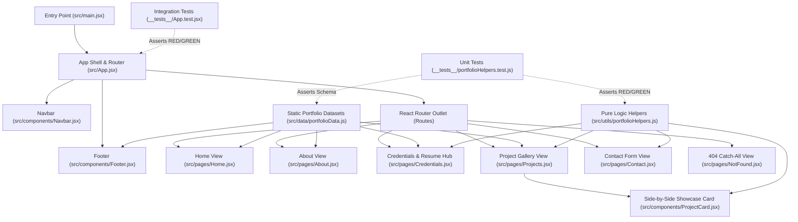

# Artifact 4: Architectural Diagram

## 1. Physical File Tree

> [!NOTE]
> This is the strict physical boundary of the system. Do not create files outside of this structure without explicit BI approval.

```text
myPortfolio/
├── artifacts/
│   ├── 01-project-overview.md
│   ├── 02-walkthrough.md
│   ├── 03-implementation-plan.md
│   ├── 04-architectural-diagram.md
│   ├── 05-logic-flowcharts.md
│   ├── 06-code-diff-specs.diff
│   └── 07-task-list.md
├── __tests__/
│   ├── portfolioHelpers.test.js
│   └── App.test.jsx
├── src/
│   ├── components/
│   │   ├── Navbar.jsx
│   │   ├── Footer.jsx
│   │   └── ProjectCard.jsx
│   ├── pages/
│   │   ├── Home.jsx
│   │   ├── About.jsx
│   │   ├── Credentials.jsx
│   │   ├── Projects.jsx
│   │   ├── Contact.jsx
│   │   └── NotFound.jsx
│   ├── data/
│   │   └── portfolioData.js
│   ├── utils/
│   │   └── portfolioHelpers.js
│   ├── App.css
│   ├── App.jsx
│   ├── index.css
│   └── main.jsx
├── .gitignore
├── babel.config.cjs
├── jest.config.cjs
├── jest.setup.js
├── index.html
├── package.json
├── vite.config.js
└── README.md
```

## 2. Component & Module Relationships



## 3. Naming Conventions & Rules

To maintain systemic integrity, the following naming conventions are strictly enforced:

- **Directories:** Lowercase (`src/components`, `src/pages`, `src/data`, `src/utils`, `artifacts`, `__tests__`).
- **Core Logic / Components:** `camelCase` for pure utility modules and data files (`portfolioHelpers.js`, `portfolioData.js`); `PascalCase` for React view and UI components (`Navbar.jsx`, `Footer.jsx`, `ProjectCard.jsx`, `Home.jsx`, `About.jsx`, `Credentials.jsx`, `Projects.jsx`, `Contact.jsx`, `NotFound.jsx`).
- **Test Files:** Located in `__tests__/` using `.test.js` for pure JavaScript unit tests (`portfolioHelpers.test.js`) and `.test.jsx` for React Testing Library integration tests (`App.test.jsx`).

## 4. Data & State Boundaries

- **Source of Truth:** Static portfolio content lives exclusively in `src/data/portfolioData.js`. Transient UI state lives strictly in the owning view component (`selectedCategory` in `src/pages/Projects.jsx`, `activeDocTab` in `src/pages/Credentials.jsx`, and `formData`/`errors`/`isSubmitted` in `src/pages/Contact.jsx`).
- **Routing & Imports:** Unidirectional data flow from `src/data/portfolioData.js` and `src/utils/portfolioHelpers.js` into `src/pages/*` and `src/components/*`. View components never mutate imported datasets directly.
