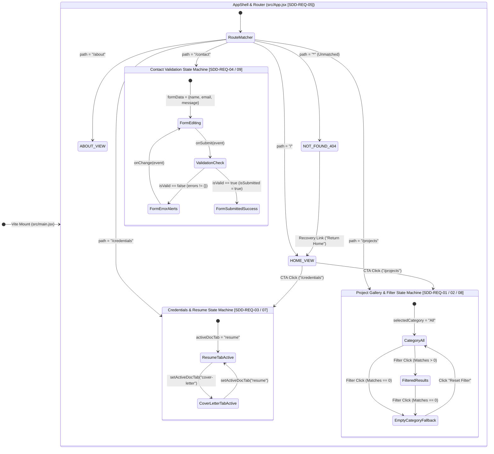
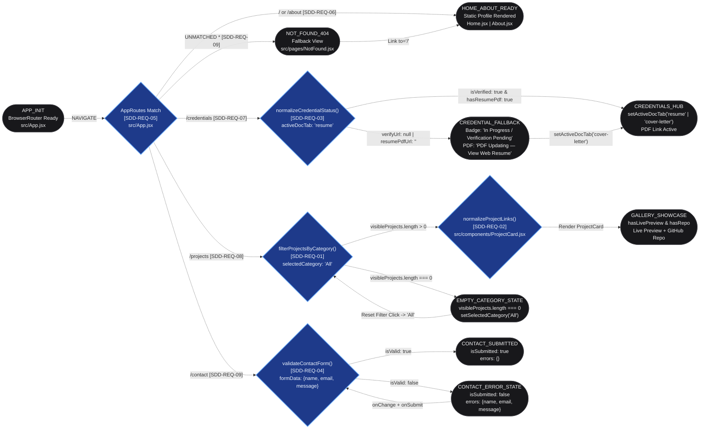
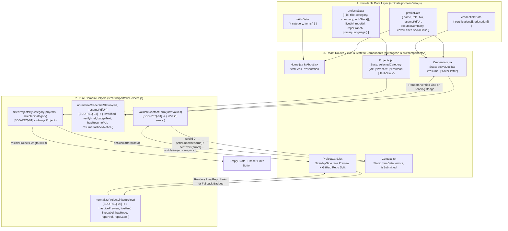

# Artifact 5: Logic & State Flowcharts

## 1. Master System Router & State Machine Topology

## 2. Core Logic & State Transitions (`av-logic-mapper` Tracker)

## 3. Unidirectional Data Flow & Prop Pipeline (`portfolioData` → Helpers → Views)

## 4. Deterministic Agent State-Transition Matrix (CLI & IDE Ingestion Map)

> [!IMPORTANT]
> Downstream agents (`av-cli-conductor`, `av-workflow-ide`, `av-instructional-scaffolder`, and `av-workflow-tdd`) must map every Flowchart Node (`A` through `N`) directly to the exact React state hooks, pure helper return contracts, and Jest/RTL assertions below:

| Flowchart Node(s) | SDD Requirement | Physical File Target | State Variable / Helper Signature | Trigger / Guard Condition | Resulting UI / DOM State & Test Assertion |
| :--- | :--- | :--- | :--- | :--- | :--- |
| **`A` → `B` → `C`** | `[SDD-REQ-05]` `[SDD-REQ-06]` | `src/App.jsx` `src/components/Navbar.jsx` `src/pages/Home.jsx` `src/pages/About.jsx` | `<BrowserRouter>` wrapping `AppRoutes()` with `<Routes>` and `<NavLink>` | Route matches `'/'` or `'/about'` | Renders `Home` hero (`<h1>{profileData.name}</h1>`) or `About` skills grid; active `<NavLink>` receives `'nav-link active'`. |
| **`B` → `D` → `C`** | `[SDD-REQ-09]` *(Edge Case 1)* | `src/App.jsx` `src/pages/NotFound.jsx` | `<Route path="*" element={<NotFound />} />` | URL does not match `/`, `/about`, `/credentials`, `/projects`, or `/contact` | Renders `404 - Page Not Found` heading and `<Link to="/">Return Home</Link>` to transition back to `C`. |
| **`B` → `E` → `F` / `G`** | `[SDD-REQ-03]` `[SDD-REQ-07]` *(Edge Case 3)* | `src/utils/portfolioHelpers.js` `src/pages/Credentials.jsx` | `const [activeDocTab, setActiveDocTab] = useState('resume')` `normalizeCredentialStatus(cert, effectivePdfUrl)` | Tab button click toggles `'resume'` (`data-testid="resume-panel"`) vs `'cover-letter'` (`data-testid="cover-letter-panel"`). Helper checks trimmed `verifyUrl` and `resumePdfUrl`. | When URLs exist (`F`): renders `Verified Credential` and PDF download link. When missing (`G`): renders `'In Progress / Verification Pending'` badge and `'PDF Updating — View Web Resume'` status. |
| **`B` → `H` → `K` → `H`** | `[SDD-REQ-01]` `[SDD-REQ-08]` *(Edge Case 3)* | `src/utils/portfolioHelpers.js` `src/pages/Projects.jsx` | `const [selectedCategory, setSelectedCategory] = useState('All')` `filterProjectsByCategory(customProjects, selectedCategory)` | Category button click sets `'All'`, `'Practice'`, `'Frontend'`, or `'Full-Stack'`. | If `visibleProjects.length === 0` (`K`), renders `'No projects found in this category'` and `'Reset Filter'` button calling `setSelectedCategory('All')`. |
| **`H` → `I` → `J`** | `[SDD-REQ-02]` `[SDD-REQ-08]` *(Edge Case 2)* | `src/utils/portfolioHelpers.js` `src/components/ProjectCard.jsx` | `normalizeProjectLinks(project)` returning `{ hasLivePreview, liveHref, liveLabel, hasRepo, repoHref, repoLabel }` | Evaluates trimmed `project.liveUrl` and `project.repoUrl` per card in `visibleProjects`. | Renders side-by-side Live App Preview and GitHub Repository panes. Missing `liveUrl` renders `Preview Unavailable`; missing `repoUrl` renders `Repo Pending`. |
| **`B` → `L` → `M` / `N`** | `[SDD-REQ-04]` `[SDD-REQ-09]` *(Edge Case 4)* | `src/utils/portfolioHelpers.js` `src/pages/Contact.jsx` | `const [formData, setFormData] = useState({ name: '', email: '', message: '' })` `const [errors, setErrors] = useState({})` `const [isSubmitted, setIsSubmitted] = useState(false)` `validateContactForm(formData)` | `handleChange` updates `formData[name]`; `handleSubmit` prevents default and evaluates `validateContactForm(formData)`. | If `isValid === false` (`N`): `setErrors(validation.errors)`, `setIsSubmitted(false)`, renders `
` per invalid field. If `isValid === true` (`M`): `setErrors({})`, `setIsSubmitted(true)`, renders confirmation banner. |
